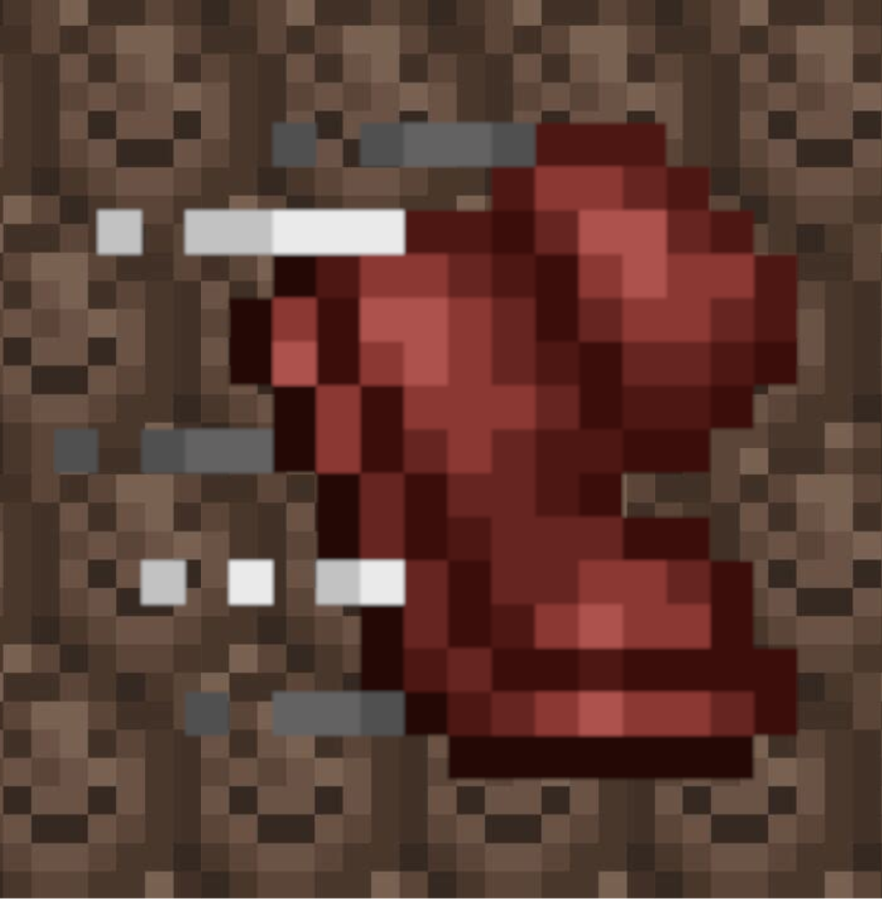
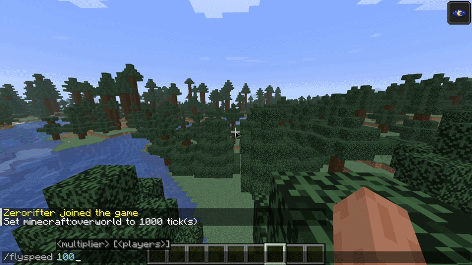

<p align="center">
  
</p>

<h1 align="center">🏃 Control That Speed!</h1>

<a href="https://market.pumpkinmc.org/plugin/rGdWTRoO-control-that-speed" title="PumpkinMC: Marketplace">
  
</a>

A lightning-fast (No pun intended) PumpkinMC plugin to control different player speed attributes




## How to use

```
/speed <type> <multiplier> [<players>]
```

Types are:

- Fly Speed
- Movement speed
- Sneaking speed
- Mining speed
- Submerged mining speed

## Editable attributes

### Fly speed

`/flyspeed` `/fs` `/speed fly`

### Movement speed

`/movementspeed`, `/movespeed`, `/ms`, `/speed movement`

### Sneaking speed

`/sneakspeed` `/ss` `/speed sneak`

### Mining speed

`/minespeed` `/ms` `/speed mine`

### Underwater mining speed

`/submergedminespeed` `/sms` `/speed submerged_mine`

## Contributing

Contributions are welcome! Feel free to submit pull requests or open issues to report bugs, suggest features, or share ideas.

---------

**Made with ❤️ by yousif51811 (Zerorifter)**
